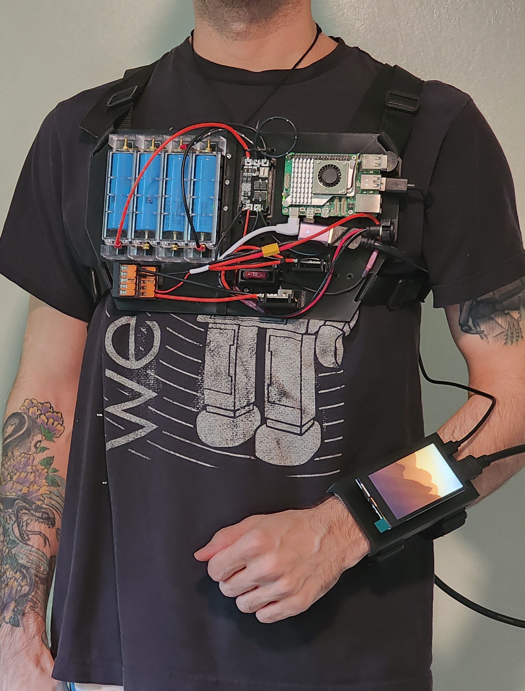

# Raspberry Pi Wearable Computer

A chest-mounted IoT computer with a wrist-mounted display, powered by a Raspberry Pi 5.

## Overview

This project is a custom wearable computing platform built around a Raspberry Pi 5. The system combines a chest-mounted computer, battery and power-management hardware, custom 3D-printed mounting components, and a wrist-mounted display.

## Current Status

Functional prototype — active development

Current development includes:
- Raspberry Pi 5 computing platform
- Custom battery and power system
- Chest-mounted 3D-printed backplate
- Wrist-mounted HDMI display
- Custom mounting hardware designed in FreeCAD
- Linux/software configuration for wearable use

## Key Features

- Raspberry Pi 5 wearable computing platform
- 2S2P lithium-ion battery system with BMS protection
- Regulated 5 V power distribution for onboard devices
- Custom chest-mounted enclosure and modular component mounts
- Wrist-mounted 800×480 HDMI touchscreen
- Custom PySide6 touchscreen interface
- Automatic kiosk startup under Raspberry Pi OS
- Windows-based preview and deployment workflow
- Direct Roku control and optional remote dashboard integration

## Hardware Architecture

The wearable is powered by a custom 2S2P lithium-ion battery pack managed by
a 2S BMS. Battery output passes through fused switching and a CK2416 buck
converter before being distributed as regulated 5 V power to the Raspberry Pi
and peripheral devices.

Mechanical components were designed in FreeCAD and 3D printed as modular
mounts attached to a custom chest plate.

## Software

The wearable runs a custom Python/PySide6 interface on Raspberry Pi OS Lite.
The application is designed around the 800×480 wrist display and includes an
animated home screen, clock, device controls, remote integrations, and safe
system shutdown.

A separate Windows preview and deployment workflow allows interface changes to
be tested before exporting the application to the Raspberry Pi.

## Project Structure

- `cad/` – FreeCAD and printable mechanical designs
- `hardware/` – electrical and hardware documentation
- `software/` – software running on the wearable
- `docs/` – design notes and project documentation
- `images/` – project photos and renders